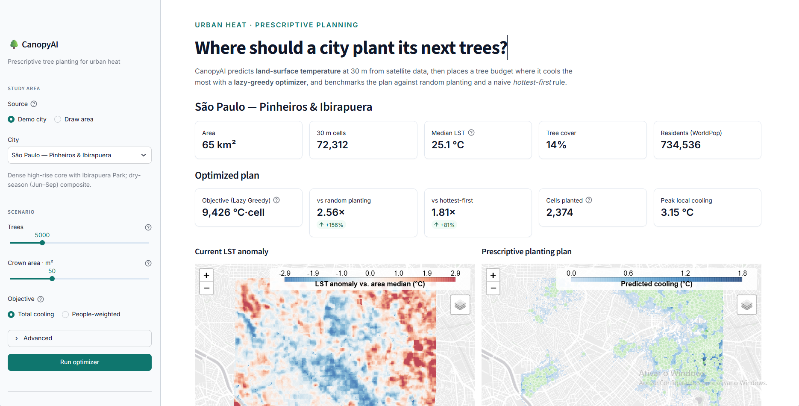
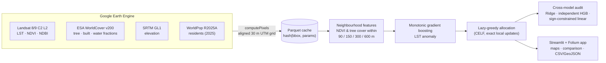

# CanopyAI — Prescriptive Urban Tree Planting for Heat Mitigation

**Where should a city plant its next *N* trees to cool the most?**
CanopyAI predicts land-surface temperature (LST) at 30 m from open satellite data, simulates the
effect of new trees on every cell and its neighbourhood, and allocates a tree budget with a
lazy-greedy optimizer. It then checks whether the plan holds up when scored by models the optimizer
never saw.

<p align="center">
  
</p>

<p align="center"><em>The app: today's land-surface temperature anomaly (left) and where 5,000 trees cool the most (right).</em></p>

> **Headline result (São Paulo, 5,000 trees):** the optimized plan beats random planting and a naive
> *hottest-first* rule under **every** model family tested. The size of the advantage depends on the
> model: **2.3× random** under tree-based models and **1.2× random** under linear models. The ranking
> of strategies is stable; the absolute cooling is uncertain. Both facts are reported below.

---

## 1. Problem

Urban heat islands make dense, impervious districts several degrees hotter than vegetated ones, and
heat exposure is unevenly distributed. Tree canopy is one of the few interventions that cools both the
surface and the air, but planting budgets are finite and planting sites are scattered. A tree planted
next to a park adds little; the same tree in a paved block can cool the cells around it. This makes
the *allocation* of trees a spatial optimization problem, not just a mapping exercise.

Most heat studies are **descriptive**: they map where it is hot. CanopyAI is **prescriptive**: it
outputs a planting plan (trees per 30 m cell), the predicted LST reduction it produces, and how that
compares with simple alternatives.

## 2. Approach



| Stage | What it does | Code |
|---|---|---|
| Composite | Median dry-season (or summer) composite of cloud-, shadow- and saturation-masked Landsat 8/9 Collection 2 Level 2 scenes; LST in °C from the official scale factors | [gee/landsat.py](gee/landsat.py) |
| Grid | UTM grid whose cell edges sit on the native Landsat lattice (15 m mod 30 m), so LST/NDVI are never resampled; WorldCover aggregated to cell fractions; WorldPop redistributed by density; tiled `computePixels` download | [gee/extract.py](gee/extract.py) |
| Cache | One Parquet file per hash of (bbox, years, months, cloud filter, schema version); a cache hit makes zero Earth Engine calls | [gee/extract.py](gee/extract.py) |
| Features | Mean NDVI and tree cover in discs of 90–600 m via **normalized convolution** (`scipy.ndimage`): water cells and out-of-grid cells are excluded from both numerator and denominator | [features/spatial.py](features/spatial.py) |
| Model | Target = LST minus the scene's median land LST. `HistGradientBoostingRegressor` with `monotonic_cst`: decreasing in every vegetation feature, increasing in built-up fraction | [models/lst_model.py](models/lst_model.py) |
| Intervention | *n* trees of mature crown area *a* add *n·a/900* to a cell's tree fraction, limited by plantable area (open land + 15% of built-up land); NDVI moves toward the scene's 95th-percentile canopy NDVI; neighbourhood features are recomputed | [optimize/allocate.py](optimize/allocate.py) |
| Optimizer | Lazy greedy (CELF) on predicted cooling **per tree**. Each move is evaluated exactly on all cells within 600 m, staleness is invalidated only within 1,200 m, and rows whose features cross no tree split threshold are skipped (provably identical predictions) | [optimize/allocate.py](optimize/allocate.py) |
| Audit | Re-scores the allocation with models the optimizer never saw | [scripts/audit_cross_model.py](scripts/audit_cross_model.py) |

### Data sources

| Dataset | Earth Engine asset | Resolution | Use |
|---|---|---|---|
| Landsat 8/9 Collection 2 Level 2 | `LANDSAT/LC08/C02/T1_L2`, `LANDSAT/LC09/C02/T1_L2` | 30 m (thermal band acquired at 100 m) | LST, NDVI, NDBI, clear-observation count |
| ESA WorldCover v200 (2021) | `ESA/WorldCover/v200` | 10 m | tree / built-up / water fractions, plantable area |
| SRTM GL1 | `USGS/SRTMGL1_003` | 30 m | elevation |
| WorldPop Global 100 m, release R2025A | `WorldPop/GP/100m/R2025A/v1/pop` (year 2025) | ~100 m | residents per cell (population-exposure objective) |

## 3. Results

Unless noted, the study area is São Paulo's expanded centre (bbox `-46.75, -23.65, -46.55, -23.50`,
563 × 688 cells ≈ 349 km²), with the June–September composite for 2022–2025 (46 Landsat scenes, median
31 clear observations per cell).

### 3.1 Physical sanity (Step 1)

| Pair | Pearson *r* | Spearman *ρ* | Expected |
|---|---|---|---|
| NDVI × LST | −0.441 | −0.424 | negative |
| NDBI × LST | +0.495 | +0.500 | positive |

### 3.2 Neighbourhood features add explanatory power (Step 2)

Ordinary least squares, out-of-sample R² under spatial cross-validation (1.5 km blocks, 5 folds),
on 335,561 interior land cells.

| Model | R² | RMSE (°C) | ΔR² |
|---|---|---|---|
| A. Cell only (NDVI + tree cover) | 0.192 | 1.41 | — |
| A + 150 m neighbourhood (best single radius) | 0.297 | 1.32 | +0.105 |
| A + all radii (90–600 m) | 0.307 | 1.31 | +0.115 |
| D. Cell + controls (NDBI, built-up, elevation) | 0.326 | 1.29 | — |
| D + all radii | **0.427** | **1.19** | +0.101 |

### 3.3 Spatial vs. random cross-validation (Step 3)

Target: LST anomaly (sd 1.57 °C). 150,000 sampled cells, 5 folds. "Spatial" uses `GroupKFold`
over 1.5 km blocks; "random" uses shuffled `KFold`.

| Model | R² spatial | R² random | Optimism of random CV | RMSE spatial | RMSE random |
|---|---|---|---|---|---|
| M0 mean baseline | −0.002 | −0.000 | +0.002 | 1.58 °C | 1.58 °C |
| M1 Ridge | 0.421 | 0.435 | +0.014 | 1.20 °C | 1.18 °C |
| M2 monotonic HGB | **0.436** | 0.488 | **+0.051** | **1.18 °C** | 1.13 °C |

The flexible model gains most from spatial leakage. Random K-fold would overstate its skill by 0.05 R².
M2 has zero monotonicity violations (largest wrong-direction change: 0.00 °C).

### 3.4 Allocation of 5,000 trees (50 m² mature crown)

All strategies are scored the same way: apply the intervention, recompute neighbourhood features by
convolution over the whole grid, predict with M2. ΣΔT = predicted LST reduction summed over cells
(°C·cell; one cell = 0.09 ha).

| Strategy | ΣΔT (°C·cell) | vs. random | Cells planted | Peak local cooling | Cells ≥ 0.1 °C cooler |
|---|---|---|---|---|---|
| **Lazy greedy** | **16,694** | **2.34×** | 2,439 | 5.03 °C | 41,769 |
| Random (mean ± sd of 5 draws) | 7,125 ± 190 | 1.00× | 2,140 | 3.61 °C | 18,277 |
| Hottest first | 6,060 | 0.85× | 2,110 | 5.37 °C | 10,489 |

No cell warms under any strategy, as guaranteed by the monotonic constraints. The greedy's incremental
estimate matches the full-grid recomputation to 0.00%. Planting in the hottest cells first is
*worse than random* here. One untested hypothesis is that the hottest cells cluster in large
impervious blocks, where a cell's own cooling saturates while little vegetation surrounds it to
benefit. The effect is not universal: in the demo cities (§3.6) the hottest-first rule beats random
in some areas.

### 3.5 Cross-model audit

Does the optimizer find real cooling, or does it exploit the step functions of its own tree ensemble?
The same allocations were re-scored by models that took no part in the optimization:

- **M2-alt**: a monotonic HGB with different hyper-parameters (63 leaves, 500 iterations, learning rate
  0.05), trained on a different half of the spatial blocks. Its split thresholds fall in different places.
- **M1**: unconstrained Ridge, a smooth model with no steps.
- **M1-sign**: linear with the same sign constraints as M2. It is smooth *and* physically consistent.
  This evaluator was added after the first audit run and is reported as a post-hoc diagnostic.

ΣΔT in °C·cell, with the ratio to random planting under the same evaluator:

| Allocation ↓ / evaluator → | M2 (optimizer) | M2-alt | M1 Ridge | M1-sign |
|---|---|---|---|---|
| Greedy optimized on M2 | 16,694 (2.34×) | 14,334 (**2.27×**) | 896 (**1.20×**) | 1,165 (1.19×) |
| Greedy optimized on M1 | 2,718 (0.38×) | 2,897 (0.46×) | 1,184 (1.58×) | 1,183 (1.21×) |
| Hottest first | 6,060 (0.85×) | 6,255 (0.99×) | 841 (1.12×) | 1,072 (1.10×) |
| Random | 7,125 (1.00×) | 6,313 (1.00×) | 748 (1.00×) | 976 (1.00×) |

What this shows:

1. **The advantage is not an artefact of M2's specific splits.** An independently trained tree model
   reproduces it (2.27× vs. 2.34×).
2. **Its size depends on the model family.** Linear models, including the physically consistent
   one, see about 1.2×. Even under M1-sign, the M2-optimized plan matches the best linear-optimized plan
   (1.19× vs. 1.21×).
3. **The absolute effect of planting differs by up to 9.5× between evaluators** (compare the
   random-planting row). Both families predict current LST about equally well (spatial R² 0.436 vs.
   0.421). Predictive accuracy on today's map does not identify the effect of an intervention.
4. **Optimizing on the unconstrained Ridge is harmful under every other model** (0.38–0.46×).
   Collinearity flips some of its coefficients, so it predicts that random planting *warms* 9,502 cells.

**Pre-registered verdict.** The criterion fixed before the run was "≥ 1.5× random under both M1 and
M2-alt". The result does **not** pass that criterion (1.20× under M1), and the verdict is reported as
such. The defensible claim is: *the optimizer beats both baselines under every model family tested;
the gain ranges from 1.2× to 2.3× random depending on how much non-linearity the model allows.* Field
data, such as LST before and after real plantings, would be needed to tell the two families apart.

Full report: [reports/cross_model_audit.md](reports/cross_model_audit.md).

### 3.6 Demo cities in the app

Default scenario: 5,000 trees, 50 m² crown, model fitted per area. Ratios are Lazy greedy ÷ baseline
on that area's objective.

| Area | Season | Median LST | Tree cover | Total cooling: vs. random / vs. hottest | Population exposure: vs. random / vs. hottest |
|---|---|---|---|---|---|
| São Paulo — Pinheiros & Ibirapuera | Jun–Sep | 25.1 °C | 14% | 2.56× / 1.81× | 2.81× / 2.21× |
| Rio de Janeiro — North Zone | Jun–Sep | 29.2 °C | 16% | 1.75× / 1.60× | 2.18× / 2.43× |
| Madrid — City Centre | Jun–Aug | 43.3 °C | 19% | 1.83× / 1.91× | 2.14× / 5.88× |
| Phoenix — Downtown | Jun–Aug | 57.6 °C | 7% | 1.62× / 1.61× | 3.51× / 21.13× |

These ratios come from the optimizing model only and inherit the model dependence shown in §3.5.

## 4. Limitations

- **Thermal resolution.** Landsat's thermal band is acquired at 100 m and delivered resampled to
  30 m. Cell-level LST is spatially smoothed, and a single-cell cooling estimate is not independent of
  its neighbours.
- **Surface, not air, temperature.** LST is the skin temperature at the satellite overpass (~10:00–
  10:30 local time). Air temperature, night-time heat and thermal comfort respond differently.
- **Mature-canopy scenario.** A planted tree is credited with its full mature crown (default 50 m²)
  immediately. Real trees take one to several decades, and mortality is not modelled.
- **Counterfactual uncertainty.** The model is correlational, learned from one composite of one area.
  As §3.5 shows, models that predict today's LST equally well disagree several-fold on the effect of
  planting. Absolute ΔLST values are model-dependent and should be read as scenario estimates.
- **Intervention simplifications.** NDBI is held fixed after planting (conservative). The plantable
  share of built-up land (15%) is an assumption exposed in the app. WorldCover is a 2021 map while the
  Landsat composite spans 2022–2025.
- **Population weighting.** WorldPop counts residents (night-time population) at ~100 m, redistributed
  to 30 m by uniform density. Daytime exposure, vulnerability and access to cooling are not modelled.
- **Optimization.** With a tree-ensemble model the objective is not submodular, so lazy greedy is a
  heuristic without the (1 − 1/e) guarantee. Exact evaluation is restricted to a candidate pool: half
  pre-screened by a linear surrogate of the model, half sampled at random.
- **Scope.** Each area gets its own model. There is no transfer across cities, and the area edges
  receive truncated neighbourhoods.

## 5. Reproducing the results

Requirements: Python 3.12+ and a Google Cloud project registered for Earth Engine. Only scikit-learn
is used for modelling; there is no deep-learning stack.

```bash
python -m venv .venv
.venv\Scripts\activate            # Windows   (Linux/macOS: source .venv/bin/activate)
pip install -r requirements.txt
cp .env.example .env              # then set GEE_PROJECT_ID
earthengine authenticate          # once; or let the first script open the browser

python scripts/test_gee_connection.py   # Step 1  physical sanity check
python scripts/verify_step2.py          # Step 2  grid, cache, neighbourhood features
python scripts/verify_step3.py          # Step 3  models, spatial CV, 5,000-tree allocation (~3 min)
python scripts/audit_cross_model.py     # Step 4  cross-model audit (~10 min)
streamlit run app.py                    # web app
```

Each verification script prints `PASS`/`FALHA` checks and exits non-zero on failure. The demo cities
ship in `data/demo/` (≈ 7 MB), so the app works without Earth Engine credentials. Refresh them with
`python scripts/precache_cities.py --export-demo`.

Deployment to Streamlit Community Cloud, including Earth Engine service-account credentials for the
custom-area mode, is described in [DEPLOY.md](DEPLOY.md).

## 6. Repository layout

```
app.py                  Streamlit + Folium web app
docs/                   README assets (screenshot.png)
app_core/               app helpers: demo cities, plan pipeline & export, UTM↔WGS84 and map rasters
gee/                    Earth Engine: Landsat preprocessing, aligned 30 m grid extraction, Parquet cache
features/spatial.py     neighbourhood features (normalized convolution)
models/lst_model.py     M0/M1/M2, spatial vs. random CV, monotonicity check
optimize/allocate.py    intervention model, lazy greedy, random and hottest-first baselines
scripts/                verification scripts for each step, cross-model audit, demo pre-caching
reports/                cross-model audit (Markdown + JSON)
data/demo/              versioned demo grids and default plans used by the app
```

Code comments and the verification scripts' console output are in Portuguese. The app and this README
are in English.

## License

Released under the [MIT License](LICENSE).
